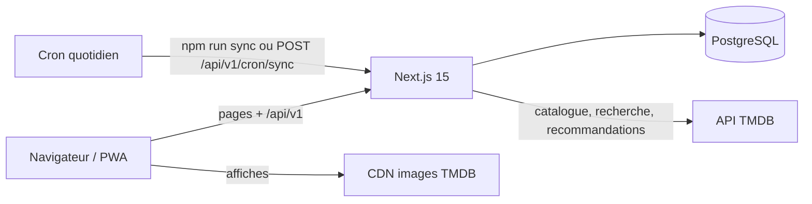

# Architecture

<!-- For developers. Explain the system so a newcomer can find their way in an hour. Update it when the structure changes. -->

## Overview

Une seule application Next.js 15 (App Router) sert les pages en rendu serveur et une API JSON `/api/v1`.
Elle s'appuie sur une base Postgres, accédée en SQL paramétré via Drizzle et postgres.js. Le catalogue
(séries, épisodes, films) est copié depuis TMDB à la première consultation, puis partagé par tous les
utilisateurs et rafraîchi par un job quotidien qui ne traite que les titres modifiés. Le choix de
conception central est un **coût par utilisateur minimal** : une requête par écran, des compteurs
maintenus à l'écriture, des images servies directement par le CDN de TMDB.

## Components

| Component | Responsibility | Tech | Location |
|---|---|---|---|
| Pages | Écrans connectés, rendu serveur, interactions optimistes | React 19, Tailwind 4 | `src/app/(app)/`, `src/components/` |
| API | JSON pour la PWA et une future app mobile ; validation, anti-CSRF, rate limit | Route handlers, zod | `src/app/api/v1/`, `src/lib/api.ts` |
| Service worker | Cache des images TMDB et des assets, repli hors ligne | JS | `public/sw.js` |
| Logique métier | Suivi, lectures, catalogue, import, recommandations | TypeScript | `src/lib/` |
| Base de données | Catalogue partagé, données utilisateurs, graphe de recommandations, imports | PostgreSQL ≥ 14 | `src/db/schema.ts`, `drizzle/` |
| Job quotidien | Synchro TMDB incrémentale, épisodes diffusés, graphe collaboratif, purge des sessions | tsx / route HTTP | `src/lib/sync.ts`, `scripts/sync.ts` |

## Main flows

**Ouvrir une série pour la première fois**
1. `GET /show/:id` appelle `ensureShow()` (`src/lib/catalog.ts`).
2. Absente de la base : appel TMDB pour la série, puis ses saisons par lots de 20 (`append_to_response`).
   Les appels simultanés sont dédupliqués (en mémoire + verrou consultatif Postgres).
3. Les épisodes sont insérés en une requête (`unnest`), et `next_episode_id` est recalculé pour les spectateurs.
4. Présente mais vieille de plus de 7 jours : servie immédiatement, rafraîchie en arrière-plan (`after()`).

**Cocher des épisodes** (`POST /api/v1/shows/:id/watched`)
1. Une requête CTE insère les épisodes (`ON CONFLICT DO NOTHING`), met à jour `user_shows` et les compteurs de `users`.
2. Une 2e requête recalcule le prochain épisode (fonction SQL `next_episode_id()`), une 3e le statut.
   Le tout en une transaction, quel que soit le nombre d'épisodes.

**Import Letterboxd** (`POST /api/v1/imports`)
1. Le navigateur lit le `.zip` (fflate), fusionne les CSV et envoie des lignes compactes.
2. Le serveur stocke les lignes (`import_items`) et répond tout de suite ; le traitement continue via `after()`.
3. Par lots de 100 : cache partagé `letterboxd_matches`, sinon recherche TMDB notée ; application au compte en une requête.
4. Un bail (`lease_until`) permet la reprise : `GET /api/v1/imports/:id` relance un import bloqué.

**Recommandations** (`GET /api/v1/recommendations`) : voir l'en-tête de `src/lib/recs.ts`
(graines pondérées → graphe `item_links` TMDB + collaboratif → qualité bayésienne → affinité de genres → diversité).

## Layers and dependencies

- Les pages (`src/app/(app)/`) et les route handlers (`src/app/api/v1/`) sont fins : ils valident l'entrée
  et délèguent à `src/lib/`.
- `src/lib/` contient la logique et le SQL. Les modules importent directement le client `db`
  (`src/db/index.ts`) : il n'y a pas d'injection de dépendances. Cette logique est donc testée contre un vrai
  Postgres jetable (embedded-postgres, voir `tests/global-setup.ts`) plutôt qu'avec des simulations de la base ;
  seul le réseau (TMDB) est simulé.
- Les composants client ne parlent qu'à l'API (`src/components/client-api.ts`).

## Data

| Table | Contenu | Remarques |
|---|---|---|
| `shows`, `episodes`, `movies` | Catalogue copié de TMDB, clé = id TMDB | Partagé par tous |
| `users`, `sessions` | Comptes et sessions | Email (donnée personnelle), mot de passe en scrypt, sessions stockées en sha256 |
| `user_shows`, `watched_episodes`, `user_movies` | Suivi, épisodes vus, films, notes | `watched_episodes` est la table qui grossit : clé composite int4 |
| `media_summary`, `item_links`, `link_fetches` | Graphe de recommandations | Partagé ; liens TMDB + co-visionnage |
| `user_feedback` | « Pas pour moi » | Par utilisateur |
| `imports`, `import_items`, `letterboxd_matches` | Imports et cache de correspondance | Cache partagé |
| `sync_state` | Curseur du job quotidien | |

Fonctions SQL écrites à la main dans `drizzle/` : `next_episode_id()`, `aired_episode_count()`,
`recompute_movie_counters()`.

Données personnelles : email, pseudo, historique de visionnage et notes. Suppression : en cascade depuis
`users`. TODO : politique de rétention, export des données et suppression de compte depuis l'interface (RGPD).

## External services

| Service | Used for | Docs / dashboard |
|---|---|---|
| TMDB API | Catalogue, recherche, listes, recommandations | https://developer.themoviedb.org/docs |
| CDN images TMDB | Affiches et images (chargées directement par le navigateur) | https://image.tmdb.org |
| Hébergement | TODO (non choisi) | TODO |

## Directory map

| Dossier | Contenu |
|---|---|
| `src/app/` | Pages (App Router), API `/api/v1`, manifest PWA |
| `src/components/` | Composants React |
| `src/lib/` | Logique métier et accès aux données |
| `src/db/` | Client Postgres et schéma Drizzle |
| `drizzle/` | Migrations SQL générées et fonctions SQL |
| `scripts/` | Seed, synchro, graphe et évaluation des recommandations |
| `public/` | Icônes et service worker |
| `docs/` | Documentation |

## Key decisions

See [decisions/](decisions/) for the reasoning behind important choices.
